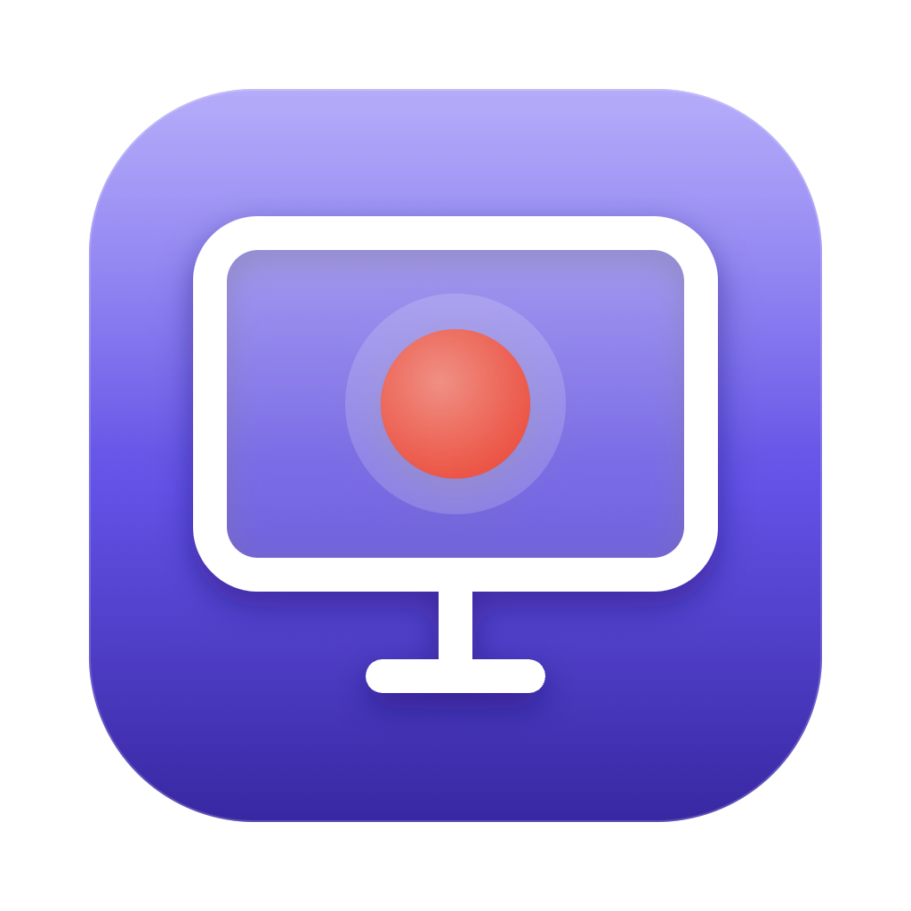
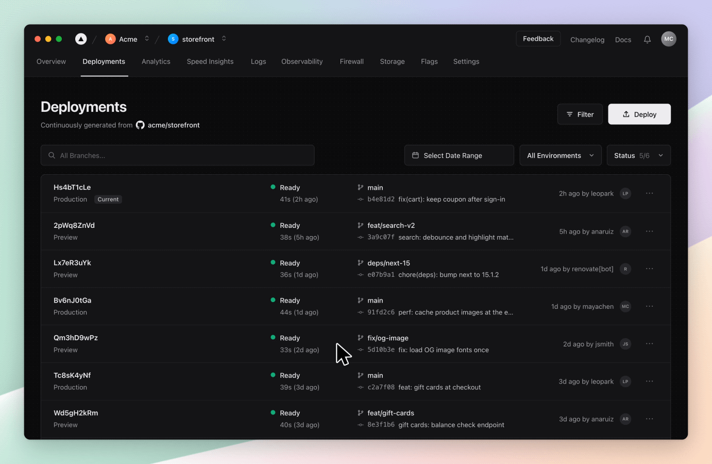
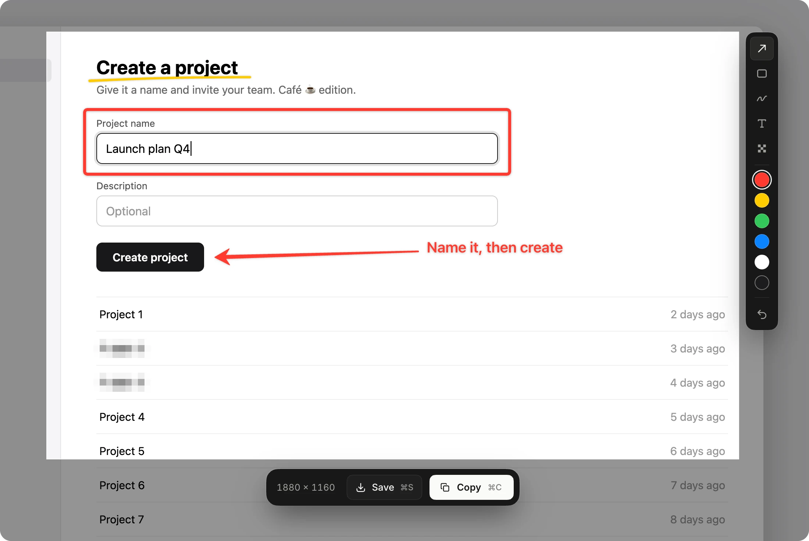
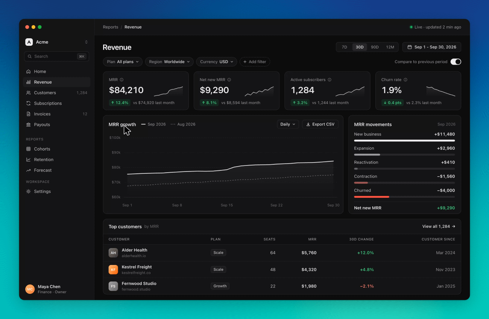
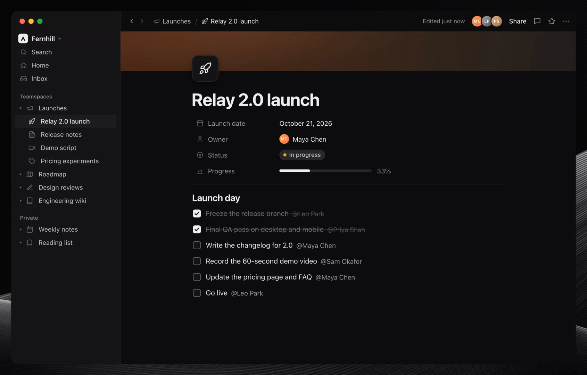
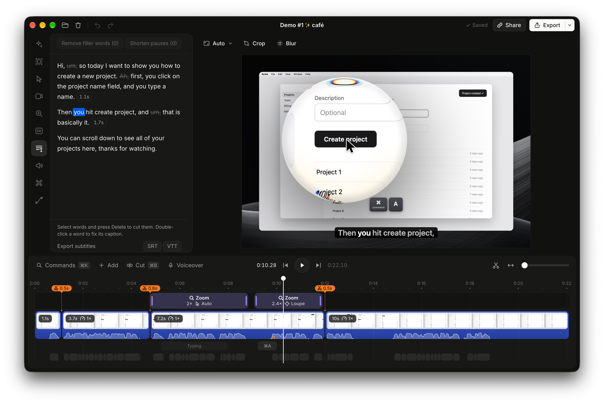
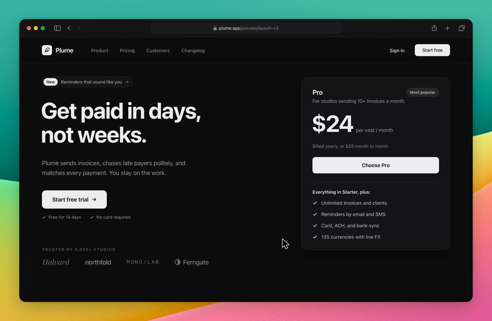
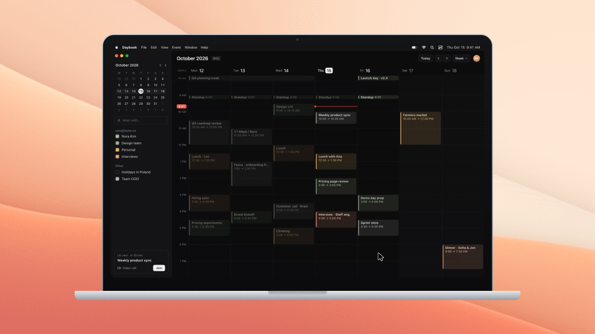
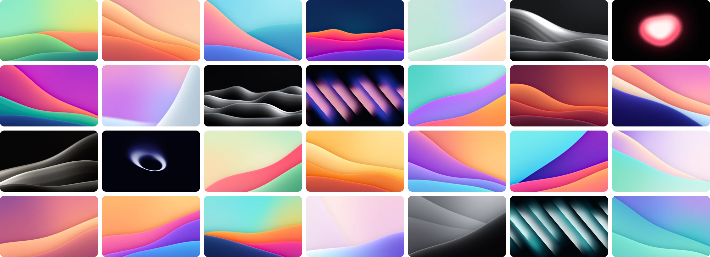
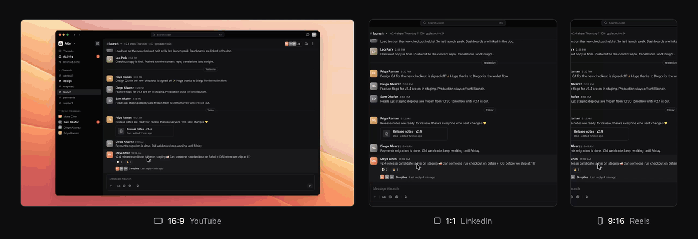

<p align="center">
  
</p>

<h1 align="center">Grip</h1>

<p align="center">
  <b>One shortcut for every screenshot and every recording.</b><br>
  Grip takes the place of your Mac's screenshot shortcut, and turns a raw recording into a polished video with no editing.<br>
  Open source. No subscription, no account, no watermark. Free for commercial use.
</p>

<p align="center">
  <a href="https://github.com/bestboyhq/grip/releases/latest"></a>
</p>

<p align="center">
  <a href="https://github.com/bestboyhq/grip/releases/latest"></a>
  
  
  
  <a href="LICENSE"></a>
</p>

<p align="center">
  <picture>
    <source media="(prefers-color-scheme: light)" srcset=".github/readme/hero-light.gif">
    
  </picture>
</p>

<p align="center">
  <sub>Exported by Grip from a raw 4-second take.
  The zoom, the smooth cursor, and the click swell are automatic.
  The only edits: a wallpaper, a glass loupe that follows the cursor and changes size, and a larger cursor.
  The take ends where it starts, so the GIF loops.</sub>
</p>

<p align="center">
  If Grip saves you an edit, <a href="https://github.com/bestboyhq/grip">a star</a> helps other people find it.
</p>

---

## What is Grip?

Grip is a screenshot tool, a screen recorder, and a video editor for the Mac, behind one shortcut.
Press it and the screen freezes, 8 ms later.
**⌘C** copies a screenshot, and **↩︎** starts a recording.

Most screen recorders are one more app to open.
Grip sits on the keys you already press: one switch in Settings puts it on **⇧⌘5**, where it opens instead of the macOS screenshot toolbar.

Raw screen recordings are hard to watch: a tiny cursor on a huge screen, nothing in focus, and a lot of "um".
A Grip recording comes out with the zooms, the smooth cursor, the captions, and the clean voice already in it.
Stop the recording, and the video is one click from your clipboard or a share link.

| Grip takes the place of | With |
| --- | --- |
| The macOS screenshot shortcut | The same keys, plus arrows, boxes, ink, text, and pixelate before you paste. |
| A screen recorder | Screen, camera, mic, and system audio on one clock, with every click and keystroke beside them. |
| A motion designer | Automatic zooms, a glass loupe, a smooth cursor, click effects, and keycaps. |
| A video editor | A transcript you edit like a doc, and a timeline you drive from the keyboard. |
| A captioning service | Captions and a cleaned-up voice, made on your Mac in 25 European languages. |
| A GIF converter and an upload tool | An MP4 under 20 MB, a GIF under 10 MB, or a link your team comments on. |

---

# Core features

## One keystroke: screenshot or video

Press your shortcut and the screen freezes under Grip's overlay, in the mode you used last, with your last area still selected.
Draw arrows, boxes, ink, and text on top, and pixelate what's private.
Then copy it, save it, or record it.

<p align="center">
  
</p>

## It zooms where you click

Clicks and typing become zooms that follow your cursor.
A glass loupe magnifies one spot and keeps the rest of the screen in view, so nobody gets dizzy.
The cursor is redrawn from your real clicks: smooth, with motion blur and a click that swells through the screen.

<p align="center">
  <picture>
    <source media="(prefers-color-scheme: light)" srcset=".github/readme/loupe-light.gif">
    
  </picture>
</p>

## Captions and a clean voice, made on your Mac

Grip transcribes your voice on device in 25 European languages, with timing for every word.
It takes background noise down, softens harsh S sounds, and evens out your levels.
Transcription needs no server and no account.

<p align="center">
  <picture>
    <source media="(prefers-color-scheme: light)" srcset=".github/readme/captions-light.gif">
    
  </picture>
</p>

## Edit a video like a doc

Select words in the transcript and press Delete, and the video follows.
Filler words and long pauses go in one click.
The timeline works from the keyboard: `C` cuts, `X` ripple-deletes, `Z` adds a zoom, and `⌘K` reaches every action.

<p align="center">
  
</p>

## Draw on screen while you record

Press **⌥⇧⌘D** and circle what you talk about.
The ink fades on its own, on screen and in the video.
A camera bubble sits right under your camera so you look into the lens, and speaker notes scroll in a prompter only you can see.

<p align="center">
  <picture>
    <source media="(prefers-color-scheme: light)" srcset=".github/readme/ink-light.gif">
    
  </picture>
</p>

## Frame it after the take

A new recording shows the screen edge to edge.
Add a MacBook, iPhone, or iPad frame and one of 165 wallpapers later, and take them back with one undo.
Every wallpaper is drawn live on the GPU, so it stays sharp at any size.

<p align="center">
  <picture>
    <source media="(prefers-color-scheme: light)" srcset=".github/readme/macbook-light.gif">
    
  </picture>
</p>

<p align="center">
  
</p>

## One take, every format

Export 16:9 for a video site, 1:1 for a feed, and 9:16 for a phone from the same recording.
Narrow formats follow the cursor, so nothing important falls out of frame.
An MP4 goes up to 4K at 60 fps, and a GIF fits under the size you set.

<p align="center">
  <picture>
    <source media="(prefers-color-scheme: light)" srcset=".github/readme/formats-light.gif">
    
  </picture>
</p>

## Your agent records the demo

Grip is an MCP server.
Claude Code, Codex, or Cursor films a UI change for the pull request, with no one at the keyboard.
The agent reads the comments your team leaves on the link, fixes what they ask, and records the next version.

```sh
claude mcp add --scope user grip -- /Applications/Grip.app/Contents/Resources/grip-mcp
```

[Other agent apps, every tool, and the `grip` CLI](docs/guide.md#agents).

---

# All features

### Screenshots

- Your own shortcut, the macOS screenshot keys included
- The overlay is up 8 ms after the keys
- An area, one window, or a whole display
- A window comes alone, with clear corners
- Arrow, rectangle, pen, text, and pixelate, each on one key, in six colors
- Pen ink that thins with speed, or with pressure on a stylus
- Move any shape, and undo any stroke
- Exact sizes, locked ratios, and window size presets
- **⌘C** copies, and **⌘S** saves to the Desktop
- Display P3 colors
- Recent Captures in the menu bar reopens the last five

### Recording

- An area, a window, a display, or an iPhone or iPad over USB
- Camera, mic, and system audio on one clock
- A 3-2-1 countdown that shows whether auto-zoom is on
- A camera bubble under your camera that stays out of the video
- Draw on screen with ink that fades
- Speaker notes in a prompter only you can see
- Grip's own windows never show up in the recording
- Hide the desktop icons
- Pause, resume, restart, or discard a take
- A warning when the mic goes silent or disconnects
- A result card after every take: copy, GIF, link, or edit
- An interrupted recording is rebuilt at the next launch

### Zoom and cursor

- Auto-zoom from clicks and typing
- A glass loupe that follows the cursor, rigid or liquid, in your size
- Every zoom is a timeline item you can move, retime, or switch off
- A smooth glide or a focused move
- A cursor redrawn from events: smoothed, exact on every click, hidden when idle
- Motion blur
- Click effects: a swell through the screen, a lit wave, a soft circle, or a focus ring
- Click sounds
- A larger cursor or a touch-style circle
- Keystrokes as macOS keycaps in your keyboard layout
- Password fields stay private

### Captions and voice

- Transcription on device in 25 European languages
- Timing for every word
- Captions a line or a word at a time, fading or sliding in
- Background noise reduction
- A de-esser and a slow leveler
- Loudness at -14 LUFS, with a limiter so nothing clips
- Subtitles as SRT or VTT, aligned through every cut and speed change

### Editing

- Edit by transcript
- Remove filler words and shorten long pauses in one click
- Fix a caption word with a double-click
- A keyboard-first timeline and a `⌘K` command menu
- Cut, ripple-delete, copy, paste, duplicate, and merge clips
- Reset a trim, or bring back anything you cut
- Crop the recording, and zooms aim inside the crop
- Speed from 0.25× to 8× with the pitch preserved
- Punch-in voiceover from the playhead
- Mic and system audio per clip, from muted to 200%
- A background music track
- Masks that blur, pixelate, or highlight, locked to the content through zooms
- Autosave, and undo for every edit

### Camera

- Picture-in-picture, fullscreen, split screen, or hidden, animated as they change
- Circle, rounded, or square, mirrored or not
- Background removal
- Face tracking
- Hide when silent
- Built-in looks or your own `.cube` LUT

### Look

- 165 wallpapers in 7 collections, drawn live on the GPU
- Your macOS wallpapers, a gradient, a color, or any image, with optional blur
- Padding, rounded corners, and a soft shadow
- MacBook, iPhone, and iPad frames
- 16:9, 9:16, 4:5, 1:1, or a custom format
- Presets that save a whole look as a portable `.grippreset` file

### Export and share

- MP4 in H.264 or HEVC, from 720p to 4K at 30 or 60 fps, hardware encoded
- A size limit that Grip fits the file under
- GIF with per-scene palettes, a loop count, and a size target
- To a file, the clipboard, or a link
- Exports queue in the background while you edit
- Batch export of many projects
- Share links with timestamped comments, private links, and view counts
- Uploads that resume after a lost connection or a restart
- Share the whole editable project with one link

### Agents and automation

- An MCP server for Claude Code, Codex, Cursor, and other agent apps
- `record_demo` films a web app with no one at the keyboard
- Agents cut, speed up, zoom, caption, export, and share your projects
- Agents read the comments on a share link and reply on each thread
- The `grip` CLI runs every tool from a shell
- `grip://` links for Raycast, Shortcuts, and scripts

The [guide](docs/guide.md) explains each one.

---

# Install

[Download the latest release](https://github.com/bestboyhq/grip/releases/latest), open the disk image, and drag Grip to Applications.
Grip is signed and notarized by Apple, and it updates itself.
It needs macOS 15 or later on Apple silicon.

On the first launch Grip asks for Screen Recording, then for your shortcut.
To use the macOS screenshot keys, allow Accessibility when Grip asks.

# Use

## Screenshot

1. Press your shortcut.
2. Drag an area, or pick a window or a display.
3. Mark it up with **A R P T B**: arrow, rectangle, pen, text, pixelate.
4. Press **⌘C** to copy it, or **⌘S** to save it.

## Record

1. Press your shortcut.
2. Press **↩︎** to record the area after a 3-2-1 countdown.
3. Press your shortcut again to finish.
4. On the result card, copy the MP4, make a GIF, get a link, or open the editor.

## Edit

1. Delete words in the transcript to cut the video.
2. Move, retime, or switch off the zooms on the timeline.
3. Pick a wallpaper, a device frame, and a format.
4. Press **⌘E** to export.

Every [shortcut](docs/guide.md#shortcuts) is in the guide.

---

# It does not break

Each bug below shipped in a real screen recorder.
Grip designs them out from the first commit instead of patching them later.

| The usual bug | How Grip rules it out |
| --- | --- |
| Subtitles drift or ignore your cuts | Captions, zooms, keystrokes, and audio all map through **one shared time map** of cuts and speed changes. |
| Zooms shift when you trim the clip before them | Every timed item lives in **source time**, so a zoom stays on its moment however you cut around it. |
| The cursor is baked into the video | The screen is recorded **without the cursor**. Grip redraws it from the event stream. |
| The export doesn't match the preview | The frame at time *t* is a **pure function** of the project and *t*, drawn by the same renderer for both. |
| A crash or power loss eats the take | Tracks are written in fragments. An interrupted recording is **rebuilt at the next launch**. |
| A full disk corrupts the recording | Grip won't start with under 1 GB free, warns when space runs low, and **keeps what it wrote**. |
| `#` or emoji in a project name breaks a feature | Names like `Demo #1 ✨ café` are **in the test suite** and the demo project. |
| Long projects make the editor crawl | The timeline is checked against a **2-hour project** with 500 cuts, 300 zooms, and 20,000 caption words. |

# Private by design

Recording, editing, transcription, and background removal all run on your Mac.
Recording and editing need no account; sharing a link signs in to bestboy.dev once.
Grip shares usage stats, like a finished recording or an export, and never what you record.
One switch in Settings turns them off, and so does `DO_NOT_TRACK=1`.
[Exactly what Grip sends](docs/guide.md#private-by-design).

# How it works

Grip is built on three rules, so the bugs typical of screen recorders cannot happen by design.

- **Raw sources, separate tracks.** Screen without the cursor, camera, mic, system audio, and the input event stream.
  Edits are data on top, and the sources never change.
- **One time map.** Every zoom, caption word, and keystroke lives in source time and maps to the output through one shared map of cuts and speed changes.
- **Pure render.** The frame at time *t* is a function of the project and *t*.
  Preview and export share one WebGPU renderer and one audio graph.

The stack: Electron and Svelte 5 for the app, a Rust addon for ScreenCaptureKit, AVFoundation, CoreGraphics event taps, and Vision, a WebGPU compositor, and WebCodecs with VideoToolbox for decoding and encoding.
[More under the hood](docs/guide.md#under-the-hood).

# Build from source

You need macOS 15 or later on Apple silicon, Node 24, Rust, and the Xcode command line tools.

```sh
git clone https://github.com/bestboyhq/grip && cd grip
npm ci
npm run build:native   # the Rust addon
npm run dev            # the app, with hot reload
```

The guide has [a demo project and the checks](docs/guide.md#build-from-source).

# Contributing

Issues and pull requests are welcome.
[Build from source](docs/guide.md#build-from-source) takes four commands.
Read [AGENTS.md](AGENTS.md) for the invariants and the code style, and the skill in [`.agents/skills/`](.agents/skills) for the area you touch: each one lists what screen recorders in that area usually get wrong.
Pull request titles follow [Conventional Commits](https://www.conventionalcommits.org), and every merged `feat` or `fix` ships to users as an in-app update.
Before your first pull request is merged, you sign the [Contributor License Agreement](CLA.md) by commenting on the pull request as the CLA bot asks.
You keep the copyright in your work, and the agreement lets the maintainer also use it under other licenses.

# License

Copyright (C) 2026 Szymon Grącki and Grip contributors

Licensed under [AGPL-3.0-only](LICENSE).
As an additional term under AGPL section 7(e), the license grants no rights to the names Grip and Best Boy or their logos: see [TRADEMARKS.md](TRADEMARKS.md).
Contributions require signing the [CLA](CLA.md).
Third-party components and their licenses are listed in [NOTICE](NOTICE).
